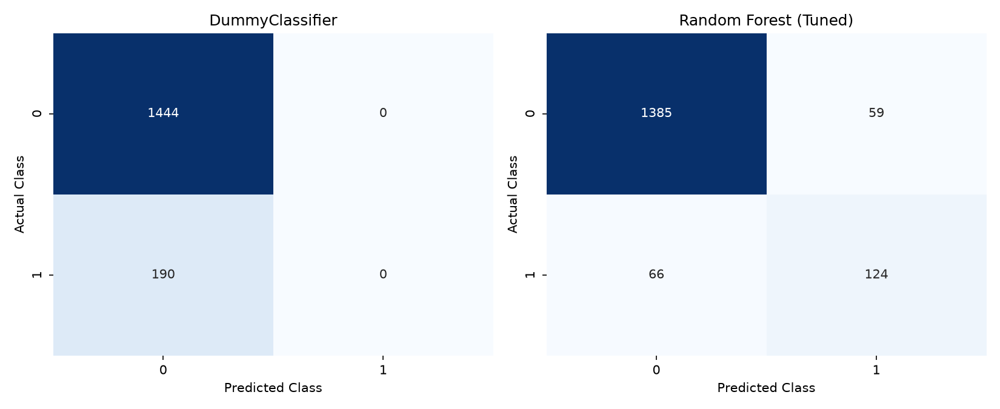

# AhR Activity Prediction

Predicting whether a chemical compound activates the Aryl Hydrocarbon Receptor (AhR) from its
molecular structure, using classical machine learning on SMILES strings.

**Status:** Complete. Eight models compared on a strongly imbalanced dataset, best F1 for the
active class 0.66.



*Left: a baseline that always predicts "inactive" — 88 % accuracy, not a single active compound found.
Right: the tuned Random Forest, which finds 124 of 190.*

## Dataset

Tox21 Data Challenge 2014, organised by the National Center for Advancing Translational Sciences
(NCATS) at the U.S. National Institutes of Health. The file `nr-ahr.smiles` holds the results of
the NR-AhR assay (PubChem AID 743122).

- source: https://tripod.nih.gov/tox21/challenge/
- license: public domain (U.S. government work)
- 8,169 compounds, no missing values
- 7,219 inactive (88.4 %) and 950 active (11.6 %)
- columns: `structure` (SMILES), `compound_id`, `activity` (0 = inactive, 1 = active)

## Tech

- Python
- pandas, scikit-learn
- matplotlib, seaborn
- Jupyter Notebook

## How to Run

```powershell
py -m venv .venv
.venv\Scripts\python.exe -m pip install -r requirements.txt
.venv\Scripts\python.exe -m pip install ipykernel
```

Open `ahr_activity_prediction.ipynb` and select the `.venv` interpreter, then run the cells from
the top. Paths are relative to the project root. The grid search takes a few minutes.

`ipykernel` is installed separately because it is a development tool, not a dependency of the
analysis.

## Project Structure

- `ahr_activity_prediction.ipynb` — the full analysis, from loading the data to the final evaluation
- `data/nr-ahr.smiles` — the Tox21 NR-AhR dataset
- `images/` — figures used in this README
- `requirements.txt` — dependencies of the analysis

## Results

All metrics below are for the active class, measured on the held-out test set
(1,634 compounds, 190 of them active).

| Model | Accuracy | Precision | Recall | F1 |
|---|---:|---:|---:|---:|
| DummyClassifier | 0.88 | 0.00 | 0.00 | 0.00 |
| Logistic Regression | 0.89 | 0.60 | 0.24 | 0.34 |
| Logistic Regression (balanced) | 0.78 | 0.32 | 0.75 | 0.45 |
| Decision Tree | 0.89 | 0.55 | 0.52 | 0.54 |
| Random Forest | 0.92 | 0.81 | 0.44 | 0.57 |
| Random Forest (balanced) | 0.92 | 0.68 | 0.63 | 0.65 |
| Random Forest (balanced subsample) | 0.92 | 0.82 | 0.45 | 0.58 |
| **Random Forest (tuned)** | **0.92** | **0.68** | **0.65** | **0.66** |

Best parameters: `n_estimators=300`, `max_depth=None`, `min_samples_leaf=1`.
Confusion matrix of the tuned model: 124 true positives, 1,385 true negatives, 59 false positives,
66 false negatives.

## How I built this

Three decisions shaped the result more than anything else.

**Accuracy had to go first.** The baseline reaches 88 % without identifying a single active
compound — it predicts the majority class every time. Four of the eight models end up at an
accuracy of 0.92, yet their F1 scores for the active class range from 0.57 to 0.66. Everything
below is therefore measured on the active class.

**Precision and recall trade against each other.** Balanced logistic regression has the lowest
accuracy of all models (0.78) and the highest recall (0.75): it finds three out of four active
compounds, at the price of two false alarms per correct hit. Which side of that trade is right
is not a statistical question. As a pre-filter for expensive laboratory assays, a missed active
compound costs more than a false alarm.

**Class weighting mattered more than tuning.** Switching the Random Forest to
`class_weight="balanced"` lifted F1 from 0.57 to 0.65. A grid search over 27 parameter
combinations added 0.01 on top. The structural decision about the imbalance was the real
lever; the hyperparameter search was close to noise.

Two details in the feature extraction are worth naming. `lowercase=False` is not cosmetic: in
SMILES notation an uppercase `C` is an aliphatic carbon and a lowercase `c` an aromatic one, so
folding the case would erase chemistry. The resulting vocabulary holds 488 character n-grams. And the vocabulary is learned from the training split
only — the test set is transformed with it, never used to build it. Inside the grid search the
vectorizer sits in a `Pipeline`, so it is refitted independently within every cross-validation fold.

## AI assistance

Parts of this README were drafted with AI assistance. The analysis, the modelling decisions and
the interpretation of the results are mine, developed with AI as a debugging and review partner.

## Known limitations

- character n-grams know no chemistry: `Cl` (chlorine) is split into `C` and `l`, so the model
  learns text statistics rather than molecular structure
- the final evaluation rests on a single train/test split; cross-validation was used only inside
  the grid search
- no external validation set, so performance on genuinely new chemical space is unknown
- a learning project, not a validated tool for biological or pharmaceutical decisions

## Planned Improvements

- chemical fingerprints (Morgan fingerprints via RDKit) instead of character n-grams
- cross-validation for the final comparison, not only inside the grid search
- a bar chart comparing recall and F1 of the active class across all models
